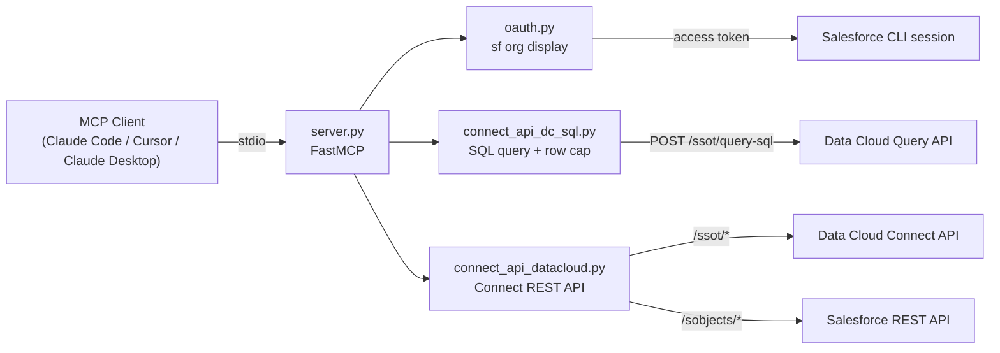

# :zap: FLASH(Framework Layer for Agentic Serverless Headless Data360)


 :ai-bot:A Headless, API-Native & Agentic AI Framework for Salesforce Data360

FLASH is a headless, API-native, agentic AI framework that transforms how Salesforce Data360 Implementations are delivered and operated.
Built on the custom Model Context Protocol (MCP), FLASH exposes 60+ intelligent APIs and operational tools that allow AI agents to autonomously execute Data360 workflows through natural language — eliminating dependency on manual UI-driven configuration.
From ingestion and modeling to segmentation, querying, and insights generation, FLASH enables organizations to operate Salesforce Data360 through a scalable headless and agentic architecture, accessible from:

* :computer: Cursor 
* :desktop_computer: Claude Desktop 
* :gear: Agentforce 
* :ai-bot:Custom AI Agents 

FLASH creates a reusable AI execution layer that standardizes, accelerates, and simplifies Data 360 operations across the enterprise.


---

## Table of Contents

1. [Prerequisites](#prerequisites)
2. [Step-by-Step Setup](#step-by-step-setup)
3. [Verify It Works](#verify-it-works)
4. [Tool Catalog](#tool-catalog)
5. [Configuration Reference](#configuration-reference)
6. [Architecture](#architecture)
7. [Security](#security)
8. [Troubleshooting](#troubleshooting)

---

## Prerequisites

Before starting, make sure you have:

| Requirement | How to check | Install if missing |
|---|---|---|
| Python 3.10 or newer (3.13 recommended) | `python3 --version` | [python.org/downloads](https://www.python.org/downloads/) |
| pip (Python package manager) | `pip3 --version` | Comes with Python; or `python3 -m ensurepip` |
| git | `git --version` | [git-scm.com](https://git-scm.com/) |
| A Salesforce org with **Data Cloud enabled** | Setup > Data Cloud | Contact your Salesforce admin |
| A Salesforce user with Data Cloud permissions | — | Use the narrowest permission set that covers the enabled tools. Keep writes and deletes disabled unless that admin access is required. |

---

## Step-by-Step Setup

Follow these steps in order. The entire setup takes about 15 minutes.

---

### Step 1: Clone the Repository

```bash
git clone https://github.com/rishiganesh25/data360-mcp.git
cd data360-mcp
```

---

### Step 2: Create a Python Virtual Environment

```bash
python3 -m venv .venv
```

Activate it:

```bash
# macOS / Linux
source .venv/bin/activate

# Windows (PowerShell)
.\.venv\Scripts\Activate.ps1

# Windows (cmd)
.\.venv\Scripts\activate.bat
```

You should see `(.venv)` in your terminal prompt.

---

### Step 3: Install Dependencies

```bash
pip install -r requirements.txt
```

This installs the MCP SDK, requests, pydantic, and other required packages.

---

### Step 4: Install the Salesforce CLI and log in

The server does not use a Connected App consumer secret. It reads the access token from an authenticated Salesforce CLI org, and it will not start unless the `sf` command is installed.

```bash
npm install -g @salesforce/cli
sf org login web --alias data360
```

Use `--instance-url https://test.salesforce.com` for a sandbox, or your My Domain URL for a production org. The user must have Data Cloud permissions.

---

### Step 5: Verify the Server Can Start

```bash
python server.py
```

You should see `Starting MCP server` in the output. Press `Ctrl+C` to stop it.

---

### Step 6: Point the server at that org

```bash
cp .env.example .env
chmod 600 .env
```

Set the alias you used above:

```bash
SF_TARGET_ORG=data360
```

Leave it unset to use the CLI's default target org. Do not put a consumer key or consumer secret in this file.

---

### Step 7: Wire It Into Your MCP Client

Pick the MCP client you're using and follow the config below.

> In all examples, replace `/absolute/path/to/data360-mcp` with the **actual full path** where you cloned the repo (e.g., `/Users/yourname/projects/data360-mcp`).
>
> If you used a virtual environment (Step 2), replace `python` with `.venv/bin/python` in the command.

---

#### Option A: Claude Code (CLI or VS Code Extension)

Create or edit `.mcp.json` in your project root (or `~/.claude/mcp.json` for global access):

```json
{
  "mcpServers": {
    "datacloud": {
      "type": "stdio",
      "command": "bash",
      "args": [
        "-c",
        "set -a && source /absolute/path/to/data360-mcp/.env && set +a && cd /absolute/path/to/data360-mcp && .venv/bin/python server.py"
      ]
    }
  }
}
```

---

#### Option B: Cursor

Open **Cursor Settings > MCP > Add new global MCP server**, or edit `~/.cursor/mcp.json`:

```json
{
  "mcpServers": {
    "datacloud": {
      "command": "bash",
      "args": [
        "-c",
        "set -a && source /absolute/path/to/data360-mcp/.env && set +a && cd /absolute/path/to/data360-mcp && .venv/bin/python server.py"
      ],
      "disabled": false,
      "autoApprove": [
        "list_tables",
        "describe_table",
        "list_data_streams",
        "list_data_model_objects",
        "list_segments",
        "list_calculated_insights"
      ]
    }
  }
}
```

> **Tip**: `autoApprove` lists read-only tools that won't prompt for confirmation each time.

---

#### Option C: Claude Desktop

Edit your config file:

- **macOS**: `~/Library/Application Support/Claude/claude_desktop_config.json`
- **Windows**: `%APPDATA%\Claude\claude_desktop_config.json`

```json
{
  "mcpServers": {
    "datacloud": {
      "command": "bash",
      "args": [
        "-c",
        "set -a && source /absolute/path/to/data360-mcp/.env && set +a && cd /absolute/path/to/data360-mcp && .venv/bin/python server.py"
      ]
    }
  }
}
```

---

### Step 8: Use it

1. **Restart your MCP client** (or reload the MCP server list)
2. **Ask it something** — for example: *"List all tables in Data Cloud"*

If the CLI session expires, run `sf org login web --alias data360` again. The server does not open its own browser login and does not store a token cache of its own. Delete tools stay refused until the call includes `confirm=true` after you approve the delete.

---

## Verify It Works

Try these prompts in your MCP client to confirm everything is connected:

| Prompt to try | Expected result |
|---|---|
| *"List all tables in Data Cloud"* | Returns a list of table names (DMOs, DLOs, CIOs) |
| *"Show me all data streams and their status"* | Returns streams with Active/Inactive status |
| *"Describe the ssot__Individual__dlm table"* | Returns column names for the Individual DMO |
| *"How many segments do I have?"* | Returns a count and list of segment names |
| *"Run this SQL: SELECT COUNT(*) FROM ssot__Individual__dlm"* | Returns a row count |

If any of these fail, check the [Troubleshooting](#troubleshooting) section.

---

## Tool Catalog

### Query & Schema (3 tools)

| Tool | What it does |
|---|---|
| `query` | Execute SQL (PostgreSQL dialect) against Data Cloud. Results are capped at 1,000 rows and 1 MB unless `MAX_QUERY_ROWS` / `MAX_QUERY_BYTES` are set. |
| `list_tables` | List all queryable tables. Filterable via `DEFAULT_LIST_TABLE_FILTER` env var. |
| `describe_table` | Get column names for a specific table. |

### Data Streams (6 tools)

| Tool | What it does |
|---|---|
| `list_data_streams` | All streams with status, source, category, and last refresh date. |
| `get_data_stream_info` | Detailed configuration for a single stream. |
| `refresh_stream` | Trigger a manual data refresh. |
| `create_new_data_stream` | Create a stream from any connector (CRM, S3, GCS, Azure, SFTP, MuleSoft, IngestApi). |
| `create_ingestion_schema` | Define the schema for an Ingestion API stream. |
| `delete_stream` | Remove a stream (and optionally its Data Lake Object). |

### Data Lake Objects (3 tools)

| Tool | What it does |
|---|---|
| `create_dlo` | Create a DLO with fields, category, and optional dataspace filters. |
| `update_dlo` | Update a DLO's label or add new fields. |
| `delete_dlo` | Delete a DLO by record ID or developer name. |

### Data Model Objects (5 tools)

| Tool | What it does |
|---|---|
| `list_data_model_objects` | All DMOs with metadata. |
| `get_dmo_details` | Fields and relationships for a specific DMO. |
| `create_custom_dmo` | Create a fully custom DMO with fields and category. |
| `create_custom_dmo_fields` | Add custom fields to an existing DMO. |
| `delete_custom_dmo_fields` | Delete custom fields from a DMO. |

### DLO-DMO Mappings (5 tools)

| Tool | What it does |
|---|---|
| `list_mappings` | All stream-to-DMO field mappings. |
| `create_dlo_dmo_mapping` | Create a mapping with pre-flight validation, auto PK/timestamp injection. |
| `update_dlo_dmo_mapping` | Update an existing mapping (delete + recreate). |
| `delete_dlo_dmo_mapping` | Delete a mapping by name or by source/target entity. |
| `batch_create_dlo_dmo_mappings` | Create multiple mappings in parallel (grouped by DLO to avoid lock contention). |

### Segments (5 tools)

| Tool | What it does |
|---|---|
| `list_segments` | All segments in the org. |
| `create_segment` | Create a segment from a JSON definition. |
| `create_segment_dbt` | Create a SQL-based segment (automatically discovers field API names). |
| `update_segment` | Update a segment (definition, schedule, description, etc.). |
| `delete_segment` | Delete a segment by API name. |

### Activations (4 tools)

| Tool | What it does |
|---|---|
| `list_activations` | All segment activations with pagination and ordering. |
| `get_activation_details` | Full details of a specific activation. |
| `update_activation` | Update activation settings (refreshType, filters, static data, etc.). |
| `delete_activation` | Delete an activation by ID. |

### Connectors (5 tools)

| Tool | What it does |
|---|---|
| `list_connectors` | All SSOT connectors (activation targets, marketing connectors). |
| `get_connector_metadata` | Metadata for a specific connector type. |
| `list_available_connectors` | Data source connectors configured in the org. |
| `list_connector_objects` | Source objects available in a connector. |
| `list_connected_source_objects` | Objects that already have streams (avoid duplicates). |

### Data Action Targets (4 tools)

| Tool | What it does |
|---|---|
| `list_data_action_targets` | All data action targets (S3, Marketing Cloud, webhook, etc.). |
| `get_data_action_target` | Details of a specific target by API name. |
| `create_data_action_target` | Create a target (Core, MarketingCloud, or WebHook). |
| `delete_data_action_target` | Delete a target by API name. |

### Data Actions (2 tools)

| Tool | What it does |
|---|---|
| `list_data_actions` | All data actions configured in Data Cloud. |
| `create_data_action` | Create a data action triggered by DMO record changes (CREATE/UPDATE/DELETE). |

### Data Spaces (5 tools)

| Tool | What it does |
|---|---|
| `list_data_spaces` | All data spaces. |
| `get_data_space` | Details of a specific data space by ID or name. |
| `update_data_space` | Update a data space's label and/or description. |
| `list_data_space_members` | All members (DMOs, DLOs, etc.) in a data space. |
| `get_data_space_member` | Details of a specific member in a data space. |

### Data Transforms (4 tools)

| Tool | What it does |
|---|---|
| `create_data_transform` | Create a transform (BATCH with STL nodes, or STREAMING with SQL). |
| `update_data_transform` | Full replacement update of a transform (PUT). |
| `delete_data_transform` | Delete a transform by name or ID. |
| `get_data_transform_run_history` | Run history with execution statuses and timestamps. |

### Calculated Insights (2 tools)

| Tool | What it does |
|---|---|
| `list_calculated_insights` | All calculated insights. |
| `create_calculated_insight` | Create a CI from a SQL SELECT expression with inferred dimensions/measures. |

### Data Graphs (4 tools)

| Tool | What it does |
|---|---|
| `list_data_graphs` | All data graph definitions. |
| `get_data_graphs_metadata` | Full metadata for all data graphs (structure, DMOs, relationships). |
| `create_data_graph` | Create a graph rooted at a primary DMO with nested relationships. |
| `delete_data_graph` | Delete a data graph by developer name. |

### Identity Resolution (1 tool)

| Tool | What it does |
|---|---|
| `list_identity_rulesets` | Identity resolution ruleset configuration. |

### Retrievers & Search (2 tools)

| Tool | What it does |
|---|---|
| `list_retrievers` | All retrievers (system + custom, for RAG use cases). |
| `list_search_indexes` | All semantic search index definitions. |

### Salesforce REST (3 tools)

| Tool | What it does |
|---|---|
| `sf_rest_api` | Read-only GET for `/services/data/.../ssot/...` or an sObject describe. Writes, Tooling API, and SOQL are refused. |
| `describe_sobject` | Get field metadata for a Salesforce sObject. The name must be a single identifier. |
| `create_sobject_record` | Create a record on an allowlisted Data Cloud object such as `MarketSegmentDefinition`. Core objects such as Account are refused. |

---

## Configuration Reference

| Environment Variable | Required | Default | Description |
|---|---|---|---|
| `SF_TARGET_ORG` | No | CLI default org | Alias or username from `sf org login web`. |
| `DEFAULT_LIST_TABLE_FILTER` | No | `%` | SQL LIKE filter for `list_tables`. Letters, numbers, underscores, and `%` only. |
| `MAX_QUERY_ROWS` | No | `1000` | Maximum rows returned by `query`. |
| `MAX_QUERY_BYTES` | No | `1000000` | Maximum serialized response size returned by `query`, including metadata. |
| `MCP_ENABLE_WRITE_TOOLS` | No | `true` | Set to `false` to refuse every create tool. |
| `MCP_ENABLE_DESTRUCTIVE_TOOLS` | No | `true` | Set to `false` to refuse every update and delete tool. |
| `MCP_ALLOWED_WEBHOOK_HOSTS` | For external targets | empty | Comma-separated HTTPS hostnames allowed for webhook and Marketing Cloud endpoints. |

---

## Architecture



---

## Security

- **Salesforce CLI session** — the server uses `sf org display` for the org named by `SF_TARGET_ORG`. It does not store a Connected App consumer secret.
- **Mutations require `confirm=true`** — delete, update, data-action, and data-action-target tools refuse to run until that flag is set after an explicit approval. Read-only tools are marked with `readOnlyHint`; deletes and updates are marked `destructiveHint`.
- **External destinations are allowlisted** — webhook and Marketing Cloud endpoints must be `https` hostnames listed in `MCP_ALLOWED_WEBHOOK_HOSTS`.
- **Tool categories can be disabled** — set `MCP_ENABLE_WRITE_TOOLS=false` or `MCP_ENABLE_DESTRUCTIVE_TOOLS=false` when the connected user should not have that access.
- **`sf_rest_api` is GET-only** — allowed paths are Data Cloud `/ssot/` resources and sObject describe. Tooling API, SOQL, composite, and write methods are refused.
- **`create_sobject_record` is allowlisted** — only named Data Cloud configuration objects can be created.
- **Path identifiers are validated** — names placed in REST paths must match letters, numbers, underscores, and hyphens, then they are URL-encoded.
- **Query results are capped** — `query` stops at `MAX_QUERY_ROWS`. The complete response, including metadata, must fit in `MAX_QUERY_BYTES`; an oversized row is omitted rather than returned.
- **Usage logs stay local and private** — they are written to `~/.data360-mcp/usage_logs` with `0700`/`0600` permissions. Arguments and errors are stored as SHA-256 hashes.
- **Rate limits are shared by category** — all destructive tools share 10 calls per minute, all writes share 20, and all reads share 120. Override with `MCP_DESTRUCTIVE_RATE_LIMIT`, `MCP_WRITE_RATE_LIMIT`, and `MCP_READ_RATE_LIMIT`.
- **Tool definitions are pinned** — startup compares the tool list with `tool_definitions.sha256` and stops on a mismatch.
- **Local transport only** — the server communicates via stdio and does not listen on a network port.

---

## Troubleshooting

| Problem | Cause & Fix |
|---|---|
| `Salesforce CLI not found` | Install the CLI with `npm install -g @salesforce/cli`, then run `sf org login web --alias data360`. |
| `sf org display` failed | The alias in `SF_TARGET_ORG` is not authenticated. Run `sf org login web --alias data360` again. |
| `403 Forbidden` from Data Cloud APIs | The logged-in user lacks permission for that Data Cloud operation. Add only the missing permission; do not grant admin access for a read-only setup. |
| `Invalid identifier` | A name passed to a tool contained `/`, `.`, or another character that is not allowed in a URL path segment. Use the API name only. |
| Refused to change data | Update, delete, and external-routing tools require `confirm=true` after you explicitly approve the action. |
| `query` result says truncated | The result hit `MAX_QUERY_ROWS` or `MAX_QUERY_BYTES`. Narrow the SQL or raise those limits. |
| Tools not showing in Cursor | Click the refresh icon in Cursor MCP settings. Verify `.venv/bin/python -m mcp --version` works. |
| `401 Unauthorized` mid-session | The CLI access token expired. Run `sf org login web --alias data360` again. |
| `ModuleNotFoundError: No module named 'mcp'` | Dependencies not installed. Run `pip install -r requirements.txt` in your activated venv. |
| `Connection refused` in MCP client | The server isn't running or crashed on startup. Check the path in your MCP config and try `python server.py` manually to see error output. |

---

## Examples

The [examples/](examples/) folder has standalone scripts using the same OAuth + API helpers:

```bash
# Count active data streams
python examples/count_streams.py

# Dump org DMO metadata
python examples/dump_metadata.py
```

Useful for verifying the Salesforce CLI login works before wiring up an MCP client.

---

## Contributing

See [CONTRIBUTING.md](CONTRIBUTING.md). Bug reports and PRs welcome.

## License

[Apache License 2.0](LICENSE.txt). See [SECURITY.md](SECURITY.md) for vulnerability disclosure.
